# Sharing Excess — Food Redistribution Platform for Sri Lanka

**Donors · Recipients · NGOs · Admin** | Nearest-first matching | Stock-tracked requests | Events | Live notifications | Trilingual

Full-stack web application for sharing surplus food in Sri Lanka. Donors post food and people nearby see it first; recipients request all or part of it and the donor accepts or declines (with a reason). On acceptance the two share contact details and arrange pickup or delivery. NGOs post events, and one admin account handles NGO approvals and moderation. It does not check food quality or supervise handovers. Built as a final-year project at Uva Wellassa University.

---

## Screenshots

**Home**

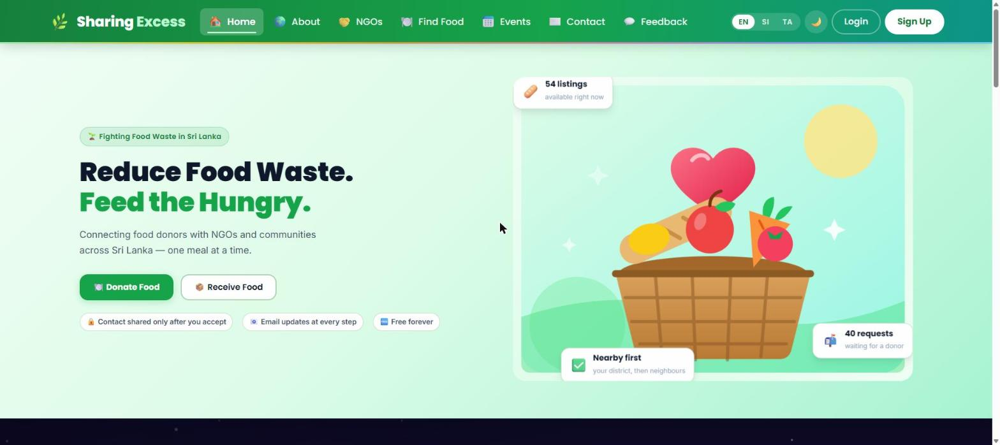

**Food near you** - a recipient in Ratnapura sees their own district first, then neighbouring districts, with the time left on each listing

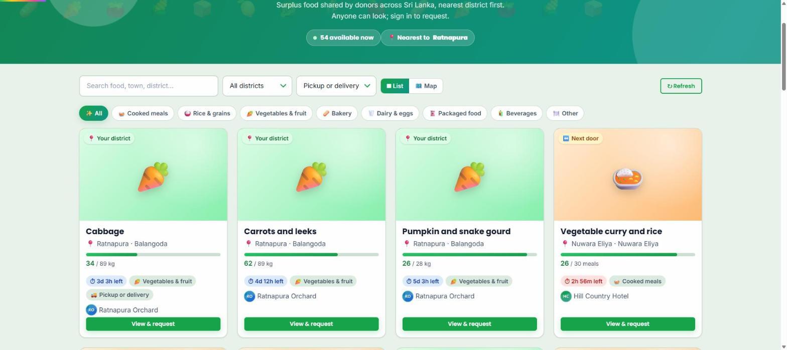

**Map view** - listings grouped by district, with a count on each pin

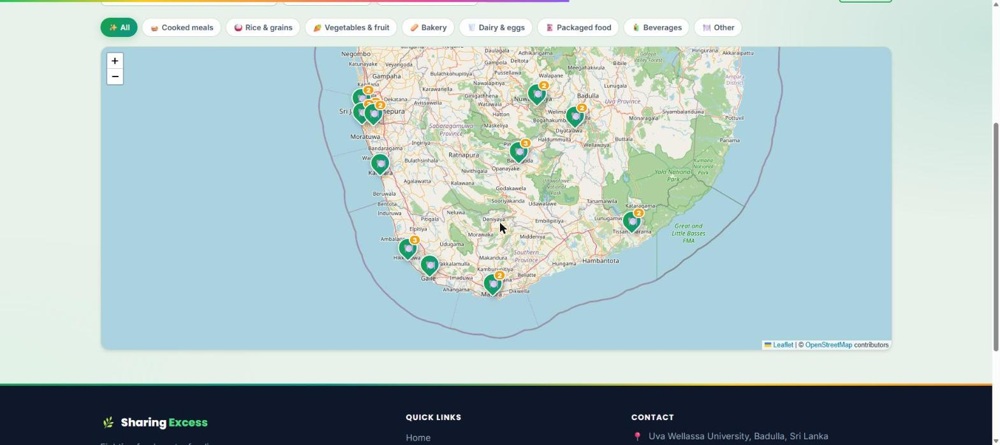

**Listing detail** - how much is left, when it expires, and a request form that holds the amount you ask for

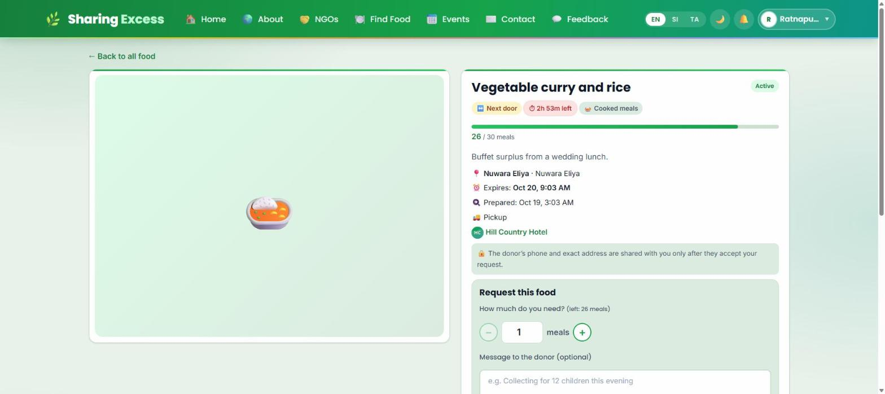

**Donor dashboard** - incoming requests with accept / decline, live stock, ratings

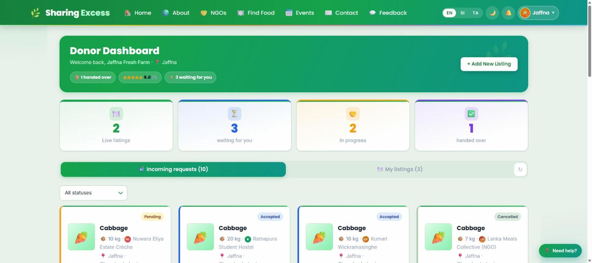

**Recipient dashboard** - each request on a Pending, Accepted, Collected, Completed timeline; the donor's contact appears only after they accept

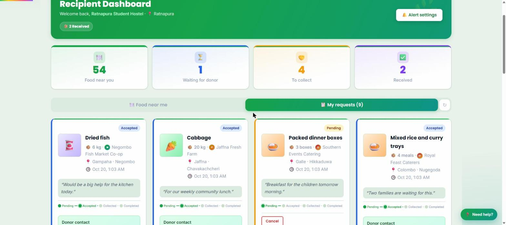

**NGO dashboard** - an approved organisation publishes events and can also request food

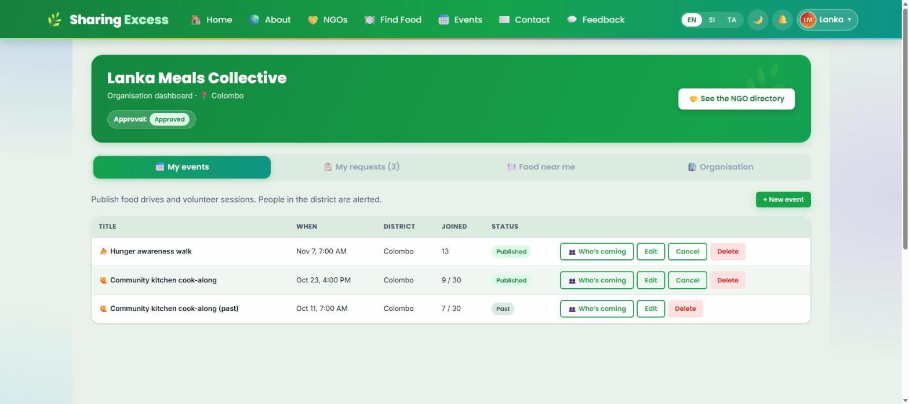

**Events** - food drives and volunteer sessions, filterable by type and district

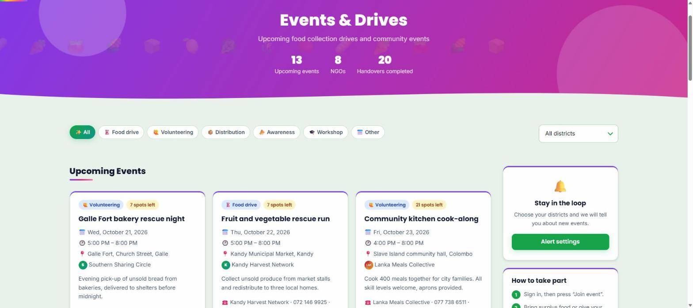

**Admin panel** - NGO approvals, listings, events, reports, users and feedback in one place

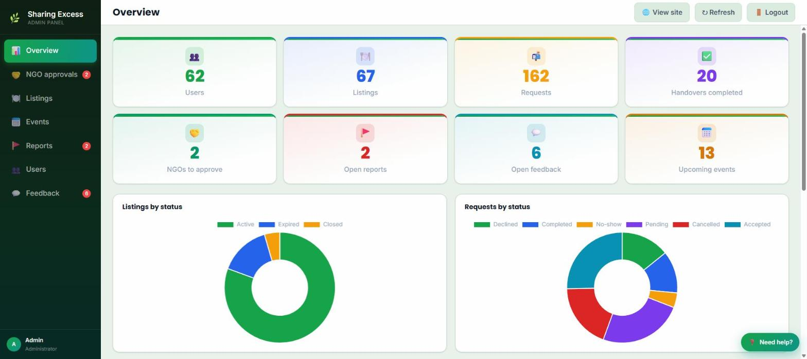

**Guided tour** (shown in dark mode) and the **phone layout**

| Guided tour | Phone |
|---|---|
| 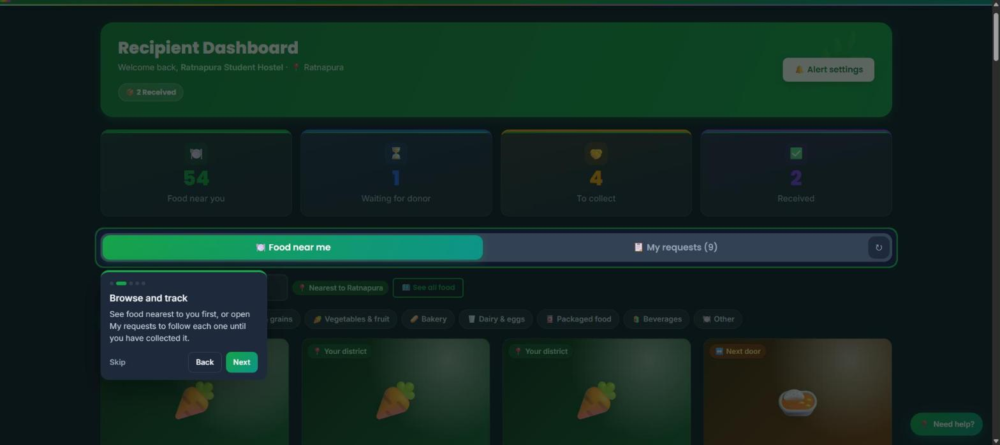 | 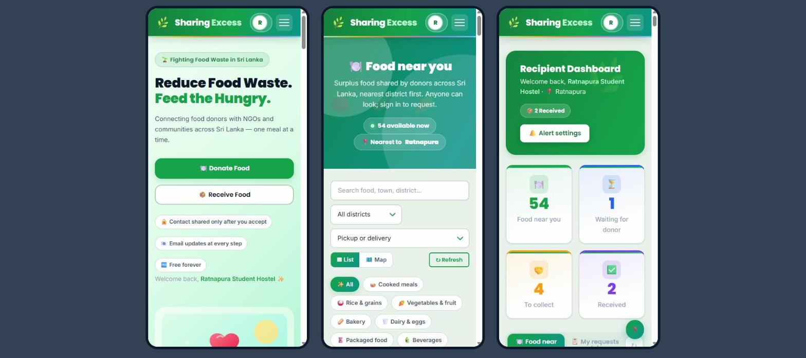 |

> The screenshots show clearly-labelled **demo data**, not real donors or recipients.

---

## What it does

**Four kinds of account**

| Role | Can do |
|---|---|
| **Donor** | Post food (1-3 photos, quantity + unit, district + town, expiry date and time, pickup / delivery, a "safe and not expired" tick). Listings go live immediately. Accept or decline requests (a decline needs a reason), mark collected / completed / no-show, rate recipients |
| **Recipient** | See food in their own district first, then neighbouring districts, then the rest. Request all or part of a listing (the amount is held for them), cancel, mark collected, rate donors. Choose which districts and food types trigger alerts |
| **NGO** | Signs up with an organisation name and waits for **admin approval**. Once approved: posts events (with photos and public contact details), appears in the NGO directory, and can request food like a recipient |
| **Admin** (`admin`) | The single admin: approve or reject NGOs, close or delete listings and events, review reports, answer platform feedback, manage users, see stats |

Visitors without an account can browse listings, events and the NGO directory. They see district and town only, never an exact address or phone number.

**How the rules work**

- 📍 **Nearest first** - same district, then bordering districts (25 districts, symmetric border table in `backend/app/constants.py`), then the rest; within each group the food that spoils first comes first.
- 📦 **Stock is held when a request is made**, under a database row lock, so two people can never be promised the same food. It returns if the donor declines, the recipient or donor cancels, the donor reports a no-show, or the listing expires. A CHECK constraint on the table is the last line of defence.
- 🔒 **Contact details stay hidden until the donor accepts**, then only that one recipient (and the donor, the other way round) sees them.
- 🔔 **Alerts** - an in-app bell plus email, filtered by each person's chosen districts and food types (default: own district and its neighbours, every type). A slow mail server never delays a request.
- ⭐ **Ratings both ways** after a handover is completed, plus a private feedback form to the admin.
- 🚩 **Reports** - anyone, signed in or not, can report a listing, user, event or request.

**Also**

- 🗺️ Map view, ⚡ live updates (Server-Sent Events), 🌐 English / සිංහල / தமிழ், light / dark mode, 🧭 guided tours, 📱 installable PWA responsive to 320 px
- 🗑️ Self-service account deletion, Privacy / Terms pages that describe what the app really does
- 🔒 Per-route authorisation, rate limiting, image re-encoding that strips location metadata (see [Security](#security))

## Tech stack

| Layer | Technology |
|---|---|
| Frontend | React 19, Vite 8, TypeScript (core) + JavaScript (older pages), React Router 7, **TanStack Query**, **React Hook Form + Zod**, Chart.js, Leaflet |
| Backend | FastAPI, SQLAlchemy 2, **Pydantic Settings**, **Alembic** migrations, Pillow, slowapi |
| Database | PostgreSQL |
| Auth | JWT (HS256) + PBKDF2-SHA256 password hashing |
| Tests | pytest (187 tests, including migration tests on a scratch database) · Vitest + Testing Library (56 tests, including a check that every UI string exists in all three languages) |
| Delivery | Docker Compose (Postgres + API + nginx), GitHub Actions CI |

## Quick start (Windows)

Requirements: Python 3.11+, Node 20+, PostgreSQL running locally.

```bash
# 1. Database - create an empty one
createdb sharing_excess

# 2. Backend
cd backend
python -m venv .venv
.venv\Scripts\python -m pip install -r requirements-dev.txt
copy .env.example .env        # then edit: DATABASE_URL, SECRET_KEY (see the file for how to generate one)

# 3. Frontend
cd ..\frontend
npm install
copy .env.example .env
```

Then start everything with **`start-services.bat`** (stop with `stop-services.bat`). The launcher checks that packages are installed and PostgreSQL is up, waits until both servers really answer, and tells you which one failed if not:

| | URL |
|---|---|
| App | http://localhost:5175 |
| API | http://localhost:8003 |
| API docs (Swagger) | http://localhost:8003/docs |

The database schema is created and upgraded automatically on start-up (Alembic).

### Demo data and a first staff account

```bash
cd backend
.venv\Scripts\python -m scripts.seed_demo --yes      # demo donors, recipients, NGOs, listings, requests, ratings and events
.venv\Scripts\python -m scripts.seed_demo --remove   # remove only the demo data again
```

Demo accounts cannot sign in. Sign up normally in the app for your own donor / recipient accounts. To create a staff account, sign up, verify the email, then promote it once in the database:

```sql
UPDATE users SET role = 'admin' WHERE email = 'you@example.com';
```

The admin signs in through the **Admin login** tab. (The admin cannot be created through the app on purpose; there is meant to be exactly one.)

## Run with Docker

```bash
copy .env.example .env      # set POSTGRES_PASSWORD and SECRET_KEY (and CORS_ORIGIN for a real domain)
docker compose up --build -d
```

App at http://localhost, API docs at http://localhost:8003/docs (this machine only). Uploaded photos and the database live in named volumes; containers restart automatically.

### Going live checklist

1. Put the site behind HTTPS (a Caddy / nginx / cloud load balancer in front of port 80) and set `CORS_ORIGIN=https://your-domain` in `.env` - email links use it too.
2. Use a long random `POSTGRES_PASSWORD` and `SECRET_KEY`; never reuse the development values.
   Also set `MAIL_USERNAME` / `MAIL_PASSWORD` (a Gmail app password): verification codes, password resets and the contact form are sent by email, so without it nobody can sign up.
3. Take a `pg_dump` before every upgrade (migrations run automatically on start-up).
4. Create the single admin once: sign up, verify the email, then run the `UPDATE users SET role = 'admin' ...` statement above inside the Postgres container.
5. Keep a single API container (see Known limitations). Check `https://your-domain/api/health` after deploying.

## Tests and checks

```bash
cd backend  && .venv\Scripts\python -m pytest -q        # API tests (use the dev database; they clean up after themselves)
cd frontend && npm test                                 # component and unit tests
cd frontend && npm run build                            # type-check + production build
```

CI (`.github/workflows/ci.yml`) runs all of the above on every push and pull request against a throw-away Postgres.

## Project layout

```
backend/
  app/
    main.py              app, middleware, startup migrations
    config.py            ALL settings (validated once, at start-up)
    models.py schemas.py dependencies.py   data model, API shapes, auth/role checks
    constants.py         districts + borders, food categories, units, event types
    routers/             auth, listings, requests, ratings, reports, notifications, ngos, community_events, admin, feedback, contact, meta, public, live
    services/            stock (held / returned quantities, expiry sweeper), notifications (bell + email), otp (e-mail codes), accounts (account purge)
    utils/               jwt, security (password hashing), uploads (image processing), email, rate limiter, live-update broadcaster, time zone and query-parameter helpers
  alembic/               database migrations (0006 is the 2026-10 redesign; 0007 dropped the old-schema safety copies)
  scripts/seed_demo.py   demo data
  tests/                 pytest suite
frontend/
  src/
    hooks/queries.ts     every server call (TanStack Query) + cache invalidation
    components/ tour/    shared UI, guided-tour engine
    lib/schemas.ts       form validation rules (Zod)
    i18n/                English / Sinhala / Tamil text
docker-compose.yml       Postgres + API + nginx
```

## Security

Written down so a reviewer doesn't have to hunt for it:

- **Identity comes from the login token, never from the request.** Creating a listing or request, answering a request, rating, posting feedback and deleting anything all use the signed-in user; ids in a request body are ignored.
- **Role and ownership checks** on every write: donors answer only requests on their own listings, recipients change only their own requests, NGOs edit only their own events, admin routes need the admin role. A request you are not part of answers 404, not 403.
- **Privacy:** exact addresses, phones and emails are never in public responses; they appear only for the donor, the admin (listing address), or the one party whose request was accepted. The admin's request lists carry no contact details. Tests assert all of this. The public home page uses a counts-only endpoint.
- **Uploads are decoded and re-encoded** as WebP (max 1600 px), which rejects non-images and removes EXIF/GPS data from phone photos.
- **Rate limits** on login, signup, verification, password reset, contact and password change.
- The app **refuses to start** without a `SECRET_KEY` of 32+ characters; secrets live in `.env` (git-ignored), never in code.
- The admin account can't be created by signup, and can't be suspended, deleted or edited from the panel.

## Known limitations

- **Live updates run in one process.** Run a single API worker (as the Docker image does), or replace `app/utils/events.py` with Redis pub/sub before scaling out.
- **Tokens last 7 days** and are not revoked on password change (a token-version column would fix this).
- **No food-quality checks.** Listings go live immediately; safety rests on the donor's confirmation, photos, expiry times, reports and the admin removing bad posts. This is a deliberate design decision.
- **The map places listings by district** (centre of the district); the exact address is never sent to guests.
- **Money donations (PayHere) were removed** in the redesign, along with the officer role and the open needs board. Migration 0007 deleted the old-schema copies, so rolling back past 0006 means restoring a `pg_dump`.
- **The expiry sweeper** runs in-process every 5 minutes (and on every browse or request), so it also assumes a single API worker.
- The NGO directory shows no email or phone; people reach an NGO through the contact details on its events.
- Some older pages (Home, About, Contact, legal text) still contain English-only paragraphs.

## Team

Developed by **Induwara Ihalavithana**, Uva Wellassa University.
